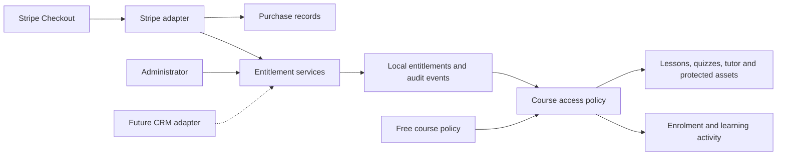

# Free and paid courses: entitlements and Stripe

Status: proposed implementation specification. This document describes the enhancement; it does not indicate that payment support has been implemented.

## Purpose and issue scope

Support both free courses and courses purchased through Stripe, while keeping the access model independent of any payment provider. A future CRM integration must be able to grant and revoke access through the same services without changing lesson access checks.

- [Issue #166: Configurable Payment Gateway (Monetization)](https://github.com/ChatBarAI/Chatbar-AI-Pte-Issue-Tracker/issues/166) is the implementation tracking issue for entitlements and Stripe.
- [Issue #90: One registration front door](https://github.com/ChatBarAI/Chatbar-AI-Pte-Issue-Tracker/issues/90) concerns registration and CRM capture. Its architectural discussion informs this design, but this enhancement does not require Fluent Forms or disable SSO.

## First-release scope

- Free and paid courses can coexist in one installation.
- Existing courses remain free after migration.
- Free courses work without a Stripe account or payment configuration.
- One-time purchases, one course per checkout, one configured currency, and access without a scheduled expiry for Stripe purchases.
- Payments go to the LMS operator's Stripe account. Course ownership does not imply a payout to the instructor.
- Stripe-hosted Checkout, local purchase records, verified payment fulfilment, and local entitlement enforcement.
- Administrator-issued complimentary grants, grant revocation, and purchase visibility.
- Refund and dispute synchronisation, durable event processing, and recovery tooling.

Deferred: CRM APIs/connectors, subscriptions, bundles, shopping carts, discounts, organisation seat allocation, instructor payouts/Stripe Connect, and multi-currency sales. Free preview lessons within a paid course and individually priced lessons/modules are also deferred. The first release supports whole free courses and whole paid courses; it does not interpret “free courses” as a request for lesson-level pricing.

## Architecture

The LMS owns learning records and enforces access locally. Stripe owns payment facts. Each entitlement source owns its own grants. Lesson requests must not call Stripe or a CRM.

Keep three concepts separate:

| Concept | Responsibility |
| --- | --- |
| Purchase | What was ordered, payment references, financial status and fulfilment outcome |
| Course entitlement | Why a particular user may access a particular course, and for how long |
| Enrolment | Participation, progress, quiz answers and completion |

An enrolment alone must not unlock a paid course. SSO authentication and organisation membership also do not constitute paid access. In particular, the existing `sso_auto_enroll` provisioning setting must not create commercial grants implicitly.

## Course configuration and learner experience

Introduce `access_policy` with `free` and `entitlement_required` values. Display these as **Free** and **Paid** in the initial course editor. Keeping the internal policy about access allows future externally managed courses to use it without requiring a Stripe purchase.

For paid courses, store a positive integer price in the configured currency's minor units, plus an explicit currency code. Do not use floating-point money or assume all currencies have two decimal places. Validate supported currency, decimal precision and provider amount limits before offering checkout.

Existing course owners and administrators may edit course pricing. Only administrators manage the site Stripe connection, financial records, or complimentary grants. Learners cannot submit prices, currencies, payment status, entitlement sources or purchase ownership through course/enrolment parameters.

| Learner state | Free course | Paid course |
| --- | --- | --- |
| Guest | Current guest/public visibility rules apply; sign-in required to enrol | Catalogue summary when guest/public settings allow; sign-in required to buy; content locked |
| Signed in, no grant | Existing free reading and enrolment behaviour | Summary and price visible; Buy course available when eligible |
| Signed in, active grant | Normal access | Start, enrol or continue without another charge |
| Signed in, revoked/expired grants only | Normal free-course rules | Content locked; learning history retained; show access status |
| Owner or administrator | Existing privileged access | Existing privileged access without payment |

Publication and authentication rules still apply. An entitlement does not publish a draft or override an organisation's SSO session policy. Ownership exceptions remain consistent with existing authoring permissions.

Course cards and detail pages show **Free**, a formatted price, or **Access available**. Paid catalogue pages expose only deliberate marketing content: description, cover and published syllabus titles. They must not render lesson bodies, quiz answers, material previews, video URLs, or tutor configuration for unauthorised users.

Preserve locale filtering, slug-based route helpers, Haml, Tailwind, and English/German translations. Include loading, processing, cancellation and failure states with accessible controls and messages.

## Proposed data model

Names below are implementation guidance; equivalent names are acceptable if the invariants remain intact.

### CourseEntitlement

- `user_id`, `course_id`.
- `source`: initially `manual` or `stripe`; allow future integration sources through deliberate application changes.
- `source_reference`: a stable identifier for this grant, independent of email and course slug.
- `status`: `active`, `suspended` or `revoked`.
- `starts_at`, optional `expires_at`, revocation/suspension reason and timestamps.
- Optional `purchase_id` and granting administrator reference.

A grant is effective when active, started, and not expired. Check time boundaries during access evaluation, so expiry does not depend on a scheduled job. Multiple grants may coexist for a user/course. Any effective grant permits access; revoking one source's grant does not revoke another.

Use database uniqueness for source/reference identity and indexes for user/course access queries. Require expiry to follow start time. Do not use a unique user/course constraint that prevents independent grants.

### Purchase

- Buyer, course, provider, test/live mode and provider account identity.
- Immutable course title and ordered amount/currency snapshots.
- Unique Checkout Session reference and payment reference when available.
- Separate payment and fulfilment states, timestamps, refunded amount and exception reason.
- Stable checkout-attempt/idempotency reference and prerequisite eligibility snapshot.

Keep failed/expired attempts distinguishable from successful purchases. Allow a later purchase after a refunded grant has been revoked. Historical purchases must not change when a course is renamed or repriced. Record tax and total separately if tax is enabled.

### PaymentEvent and EntitlementEvent

Persist a payment inbox with provider event ID, account/mode, event type, processing state, attempt count and error summary. Enforce unique provider event identity. Retain only the payload fields required for processing and investigation, with an explicit retention policy for personal data.

Maintain an append-only entitlement audit trail recording actor/source, grant, action, time, reason and correlation reference. Updating an entitlement row alone is not an audit trail.

Deletion rules must preserve financial and access history. Do not cascade-delete purchases when an enrolment is removed. Block destructive course deletion when purchases require retention; use unpublishing instead. Define user anonymisation/retention behaviour before enabling live sales.

## Shared services and authorization

Introduce a central access policy and focused services such as `Entitlements::Grant`, `Entitlements::Suspend` and `Entitlements::Revoke`. Services validate source ownership, use transactions and record audit events. Stripe-specific code translates payment facts into calls to these services; it must not add Stripe checks throughout controllers.

Use the same policy in `Ability`, enrolment creation and every learner action. Remove broad published-lesson permissions that would bypass the paid-course condition. Preserve queryable CanCanCan rules or equivalent scoped queries so catalogue rendering does not load all grants or issue one query per course.

Apply access checks to:

- Lesson reads, starts, quiz submissions, progress updates and material acknowledgements.
- Questions, lesson materials, generated document/design previews and asset endpoints.
- Embedded tutor rendering and token-based lesson API responses.
- Active Storage blobs, variants, representations, rich-text attachments and uploaded videos.

The existing `ActiveStorageAccessControl` concern must distinguish public marketing assets from protected learning assets. A paid course cover may be public when its catalogue page is public; course readability must not make certificate templates or other protected attachments public. The current guest/public checks must never bypass entitlement requirements for paid lesson content.

Serve protected assets through authorised proxy routes, preserve private/no-store responses, and audit redirect routes and shared blobs. Private storage must not expose public object URLs. Previously issued storage URLs may remain valid until expiry; document this boundary. External videos such as public/unlisted YouTube URLs cannot provide equivalent revocable delivery: the LMS can hide the embed but cannot control access at the external host.

Retain earned certificates and completion history after access revocation. Existing certificate ownership and public verification rules continue to apply; financial refunds do not silently invalidate academic achievements.

## Checkout and fulfilment

1. Require an authenticated user and valid session policy. Authorize the published course and verify prerequisites before creating checkout.
2. If a valid grant already exists, direct the user to enrol/start/continue. Do not create another charge.
3. Create a local purchase attempt with server-owned course, user, currency and price snapshots. Serialize concurrent starts for the same user/course and reuse a still-valid pending session.
4. Create Stripe Checkout in one-time payment mode using a stable idempotency key. Recover safely if Stripe creates the session but the local request times out.
5. Redirect to Stripe. Generate return URLs from trusted application configuration, not arbitrary request parameters.
6. On verified successful payment, reconcile the payment with the local purchase. In one local transaction, record fulfilment, grant access and create/reuse enrolment.
7. Show a processing state while fulfilment is pending. The return page may call the same server-side reconciliation service after retrieving Stripe state; reaching the page or supplying a session ID is never proof of payment.

Only accept a paid session matching the expected account, environment, local purchase, buyer, course, amount and currency. Ownership checks must prevent a user from inspecting or claiming another user's session. Free courses bypass Stripe entirely.

Prerequisites are checked before charging. If prerequisites change while checkout is open, honour the recorded eligibility for that purchase using a narrowly scoped fulfilment path. If the course becomes unavailable, record the successful payment and surface a fulfilment exception for support/refund; do not silently lose the payment or bypass draft protection.

Price changes affect new sessions. Honour an already-open session's quoted price until expiry. Expire superseded sessions before offering replacement checkout where possible. Fulfilment deduplication does not itself prevent two charges: detect any extra successful payment for the same access and flag it for refund resolution without creating duplicate enrolments.

Stripe requires webhook-backed fulfilment and repeat-safe processing; see [Stripe Checkout fulfilment](https://docs.stripe.com/checkout/fulfillment). The transaction and eligibility rules above are LMS design requirements.

## Webhooks, jobs and recovery

Expose a dedicated Stripe webhook endpoint. Verify signatures against the raw request body and configured endpoint secret before persisting events. Exempt only this signed endpoint from browser CSRF protection. Preserve normal CSRF protection for checkout and administrative actions.

Durably persist the event before acknowledging it, then process through ActiveJob. The current application config uses Sidekiq/Redis; payment processing should reuse it. Database inbox recovery must cover a crash between event persistence and queue submission. Provide a scheduled dispatcher/recovery task and document how it is scheduled; merely defining a job is insufficient.

Support duplicate deliveries, concurrent fulfilment, events received out of order and worker restarts. Event deduplication and purchase-level locking are both required. Reconcile current provider state where ordering is uncertain, so a late success notification cannot resurrect refunded or revoked access.

Handle completed checkout, expiry, successful refunds and dispute lifecycle updates. The initial payment-method configuration should use immediate-payment methods only. If delayed methods are subsequently enabled, asynchronous success/failure events and pending states must be supported before launch of those methods. Unsupported events should be acknowledged without changing access.

Provide recovery for stale purchase attempts, pending fulfilment and failed inbox events, plus periodic reconciliation of relevant Stripe purchases for missed refund/dispute changes. Track last successful processing, oldest pending event and failures. Alert operators to paid-but-unfulfilled purchases and provide safe retries.

Webhook signature verification, duplicate handling and unordered delivery are described in [Stripe's webhook documentation](https://docs.stripe.com/webhooks). Select and pin a supported API version during implementation.

## Refunds, disputes and access lifecycle

Proposed first-release policy:

- Initiate refunds in the Stripe Dashboard; an LMS refund UI is deferred.
- A confirmed full refund revokes only that purchase's grant.
- A partial refund records the financial adjustment and retains access.
- An open dispute suspends only the affected purchase's grant. A lost dispute revokes it; a won dispute may restore it only if no refund or independent revocation prevents restoration.
- Failed or pending refunds do not count as completed refunds.
- Manual grants remain independent. Repeating an old grant request must not undo an explicit revocation; restoration is a distinct audited action.
- Revocation or expiry preserves enrolment, progress, answers and completion. Paid-course withdrawal should archive participation rather than invoke the existing destructive unenrolment path. Rejoining with valid access must not charge again.

These commercial policies must be reflected in purchaser-facing terms before live sales.

## Administration and configuration

Add a Payments section to site settings with enablement, configured currency, test/live indicator, webhook URL, readiness checks and processing health. Store secret keys and webhook secrets in deployment environment variables or Rails credentials; display only masked/configured status. Filter secrets and sensitive webhook fields from logs.

Disabling payments disables new checkout only. Existing entitlements remain effective, and webhook/refund processing continues. A Stripe outage similarly prevents new sales without interrupting already-granted course access. Separate test and production data; reject environment/account mismatches.

Provide administrator views of purchases, payment/fulfilment exceptions and entitlement history. Allow manual grants with a required reason and optional expiry, plus explicit revocation. Ordinary admin enrolment into a paid course must either use existing access or explicitly create an audited complimentary grant; it must not silently bypass the policy.

Use one configured currency initially. Changing it must not reinterpret existing price integers or historical purchases. Require explicit repricing of existing paid courses before enabling checkout in a new currency.

Before live rollout, confirm seller identity, currency, tax-inclusive/exclusive display, receipt configuration, refund terms and support contact. Tax configuration must be explicit; do not silently assume tax is zero. If automatic tax is enabled, save base/tax/total snapshots and reconcile against the server-created checkout configuration. Formal invoicing integrations are outside this release.

## Migration and rollout

1. Add tables and course fields with backward-compatible defaults. Set existing courses to free; do not backfill synthetic purchases.
2. Implement and test entitlement policy, manual grants and protected asset checks while checkout remains disabled.
3. Add Stripe test configuration, checkout, inbox processing, reconciliation and administrator views.
4. Run staging acceptance checks with real Stripe test-mode deliveries, including restarts and replay.
5. Configure live credentials, webhook destination and recovery scheduling; enable selected paid courses after readiness checks pass.

When converting a free course to paid, preserve existing enrolled learners through audited migration grants created atomically with the policy change. New learners must purchase or receive a grant. Prior anonymous readers have no durable identity to grandfather. Converting paid to free preserves purchase and grant history and does not automatically refund earlier buyers. Clearly explain these transitions in the editor.

Rollback should disable checkout while retaining entitlement enforcement and payment processing. Do not deploy an older build that broadly exposes paid lessons or drop payment tables after collecting live payments. Backups and restores must include purchase, entitlement and inbox records; reconciliation is required after a restore.

## Future CRM extension

Future adapters call the same grant/revoke services with a stable source namespace and reference. Keep user and course identifiers independent of email addresses and mutable slugs. CRM grants can coexist with manual and Stripe grants.

Define source authority, identity mapping, updates/version ordering, replay rules and reconciliation when implementing each integration. A CRM may be authoritative for its grants without deleting access from another source. A local mirror remains available during external outages and still honours known expiry dates.

Do not build a generic connector registry, inbound CRM endpoint, message broker or separate entitlement service in this release. An eventual inbound-only integration needs snapshots from its upstream source or middleware to reconcile; the LMS cannot infer CRM state on its own.

## Acceptance criteria

| Area | Required verification |
| --- | --- |
| Free courses | Existing courses stay free; browsing, enrolment and learning work with Stripe unconfigured or disabled |
| Guest policy | Free guest access remains conditional on publication/public/site settings; paid learning content stays locked |
| Paid catalogue | Correct price/currency and marketing content appear without exposing protected content |
| Purchase | Signed-in eligible learner reaches checkout with the server-defined course and amount |
| Prerequisites | Ineligible learner is blocked before payment; later prerequisite changes follow the recorded purchase eligibility |
| Fulfilment | Confirmed payment creates one purchase fulfilment, grant and enrolment even without browser return |
| Failure paths | Cancelled, declined, expired and unpaid sessions grant no access; processing and recovery states are understandable |
| Concurrency | Double clicks, multiple tabs, duplicate events and return/webhook races do not duplicate access; extra charges are detected |
| Validation | Forged signatures, foreign sessions, wrong users, amount/currency mismatches and test/live mismatches are rejected |
| Authorization | Direct lesson, quiz, material, token API and progress requests cannot bypass entitlement checks |
| Storage | Blob/proxy/redirect/variant/rich-text/design paths enforce access; paid covers remain usable as marketing assets |
| Independent grants | Revoking or refunding one grant does not remove another valid grant |
| Lifecycle | Full/partial refunds and disputes follow policy; late success cannot undo revocation |
| Learning history | Revocation and paid-course withdrawal retain progress and certificates; rejoining does not require repurchase |
| Administration | Only authorized owners/admins edit prices; only admins configure payments or issue audited grants |
| Course changes | Repricing, free-to-paid grandfathering, paid-to-free and unpublishing follow the documented rules |
| Operations | Worker failure, queue submission failure, missed events and restart recover without lost paid orders |
| Regression | Owner/admin access, SSO session policy, locale filtering and existing free-course behaviour remain intact |

Implement focused model, service, request and job tests for these invariants, plus staging checks for the real hosted checkout and webhook lifecycle. Tests must not require live charges. Per repository instructions, a human runs targeted Rails tests and the full `bin/rails test` suite against local PostgreSQL; agents must not run Rails tests from the sandbox.

## Main implementation touchpoints

- `app/models/course.rb`, new purchase/entitlement/event models and migrations.
- `app/models/ability.rb`, enrolment model/controller and admin enrolment action.
- Shared access and entitlement services; Stripe checkout/fulfilment adapter and processing jobs.
- `app/controllers/concerns/active_storage_access_control.rb`, asset controllers and lesson API.
- Course cards/detail/editor views, learner dashboard and admin purchase/entitlement views.
- Site settings, routes, credentials/environment documentation, deployment and recovery tasks.
- Locale files, regression tests and an updated staging checklist linked from issue #166.
